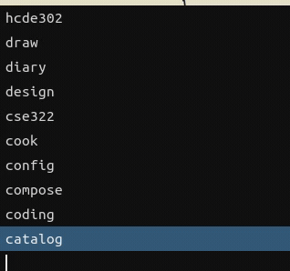
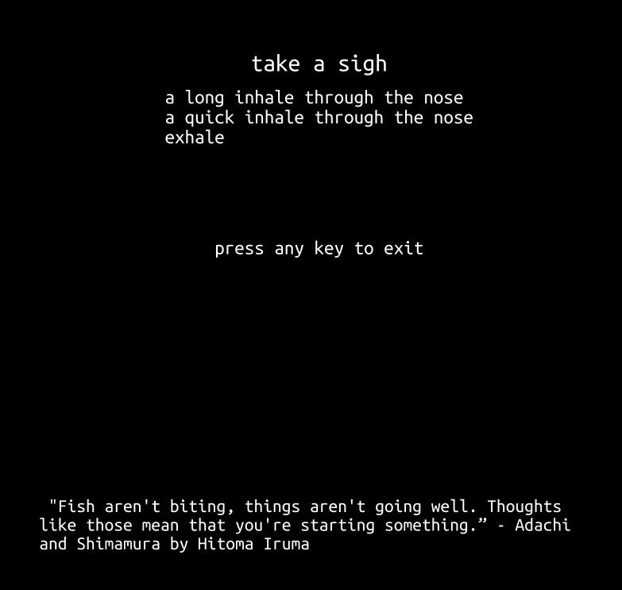

One personal issue I was struggling was with my [Sway](https://swaywm.org/) setup. Sway is a window managing environment on Linux which is key binding first which makes desktop window management fast. However, I often find myself disorganized and getting distracted.

In other words, I needed:

- a system that helps me keep my windows organized
- a system that prevents me from being distracted from side tasks

## Being Organized

Previously, I was using numbers to organize my workspaces. This made sense because each number associated with a shortcut. However, it made impossible to figure out what the workspace was actually for!

I added names to the bar on top of Sway to clearly to give each workspace clear role.

| Before | After |
| :--- | :--- |
|  |  |

However, I do different tasks everyday! I also added a key binding to allow a user to enter name a workspace. Because typing original names is annoying, I focused recognition over recall through a use of a menu in order to search up potential names for your workspace.

## Distraction Prevention

In order to workspace switching more deliberate, I developed an automatic wellness screen to encourage the user to stop what they are doing and do breathing exercises. The steps of wellness screen are skipable, in order to make the experience to feel intrinsic rather than extrinsic (see [overjustification effect](https://en.wikipedia.org/wiki/Overjustification_effect)). 

[Link to Figma](https://www.figma.com/design/rJcyFgkbUD55CSCp3Xq8Q2/Untitled?node-id=0-1)

## Closing Notes

This tool is available in [Github](https://github.com/pbun206/sway_productivity_cli). However, the problem scope is quite niche so in the future, I hope to bring similar workflows for more accessible Linux Desktops like [KDE Plasma](https://kde.org/plasma-desktop/).
