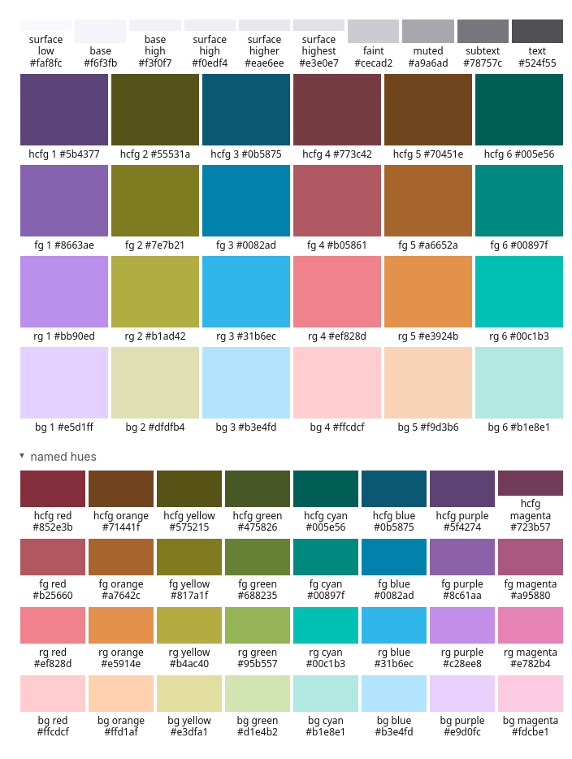
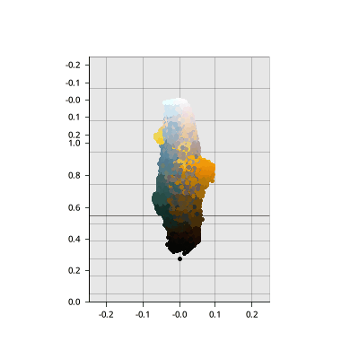
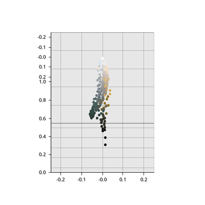
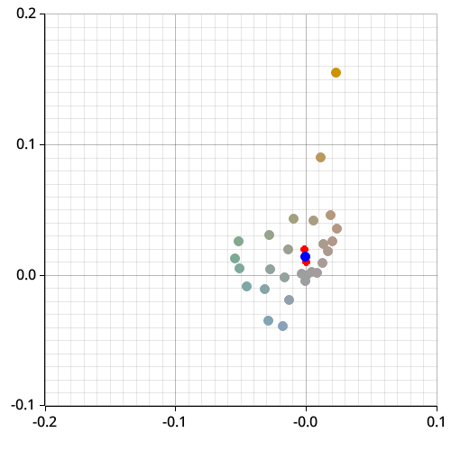
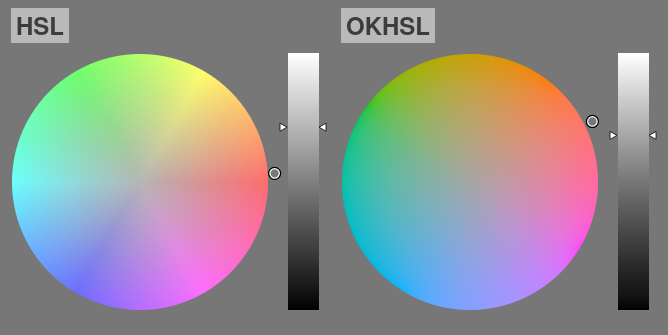
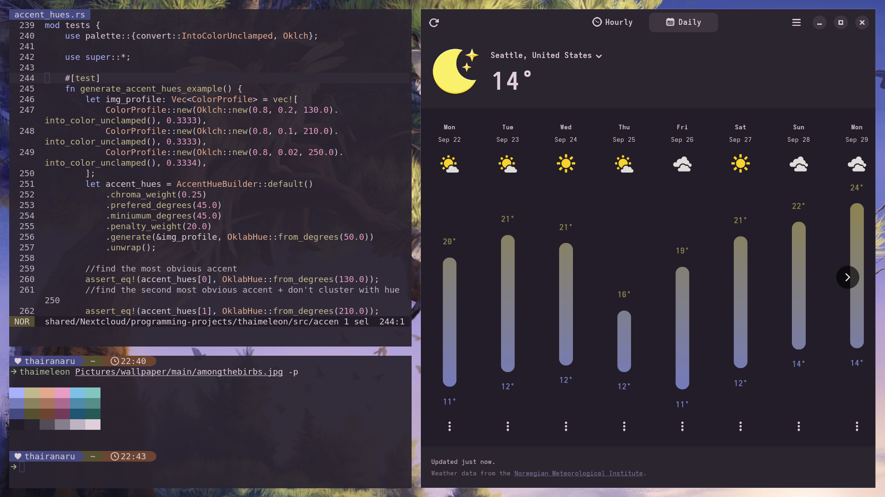

Three years ago, I became involved in “ricing”, a creative practice of personalizing a desktop graphical interface to your own. Rices commonly utilize machine-generated color schemes to bring a cohesive appearance. However, I noticed that these color scheme generators often create inaccessible, often gray, text colors. Through Discord, I learned I was not the only one frustrated by these accessibility barriers. I decided to build my own color scheme generator myself.

There were three core challenges:

- Determine what color roles to generate
- Compute colors that are both accessible and useful for interfaces

## Determine what color roles to generate

Although I began by copying preexisting standards, through testing and theming of multiple applications, throughout time, I added new color roles.

## Compute colors that are both accessible and useful for interfaces

I utliized unsupervised machine learning to take an image into color scheme.

1. Use online k-means to simplify pixels of an image

| Before | After |
| --- | --- |
|  | |

2. Use hierarchical clustering to determine hue accents

> Colors that are closer to others get removed. The ones that remain become the final accent hues.

3. Use scientific-backed systems DPS for contrast and Oklch for hues to generate colors

> Smoother, the more perceptual the color space is. This visualization was made by [Bottosson](https://bottosson.github.io/misc/colorpicker/#1037168).

Many current color-scheme generators use WCAG 2, RGB, HSL, or HSV which are not actually perceptual to human vision. We use modern color formulas to ensure the color scheme have predictable contrast.

## Results

> Example of the color scheme being in used

- First color scheme generator to use perceptual contrast and account multiple color hues
- Over 800+ downloads

